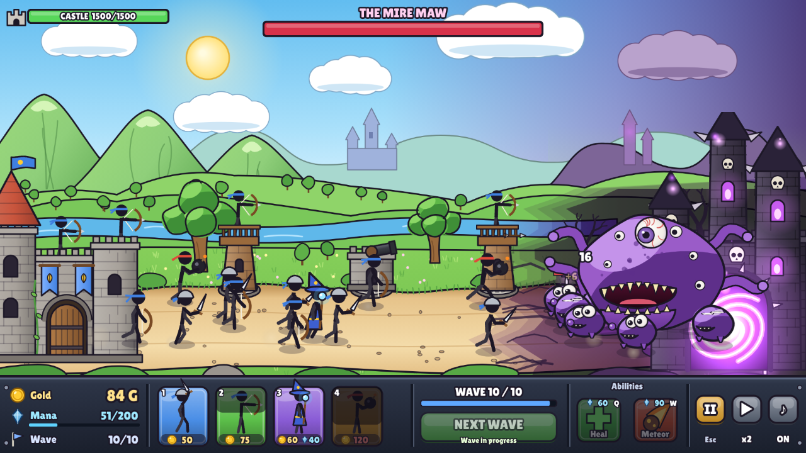

# Natura

棒人間の兵を出して、穢れの砦から湧く怪物の波から城を守る、ブラウザの城防衛ゲーム(試作版)。



## 遊ぶ

PowerShell で:

```powershell
cd <このフォルダ>
npm.cmd install
npm.cmd run dev
```

表示された `http://localhost:5173` を開く。

| 操作 | キー |
|---|---|
| 兵を出す | カードをクリック / `1`〜`4` |
| 回復・隕石 | ボタン / `Q`・`W`(隕石は続けて戦場をクリック) |
| タワーを建てる | 道沿いの丸い土台をクリック |
| 次のウェーブを早く呼ぶ | 「次のウェーブ」/ `Space` |
| 一時停止・速さ | `P`・`F` |

## 作り方(Claude Code 向け)

`CLAUDE.md` を見る。企画は `docs/GDD.md`、画風は `docs/style-bible.md`、生成画像への差し替えは `docs/asset-pipeline.md`、これからの進め方は `docs/roadmap.md`。

| やること | コマンド |
|---|---|
| 型チェック + テスト | `npm.cmd run check` |
| バランス検証(自動プレイの勝率) | `npm.cmd run balance -- 60` |
| 画面を撮る | `npm.cmd run screenshot`(初回だけ `npm.cmd i -D playwright` と `npx.cmd playwright install chromium`) |
| 本番ビルド(`dist/` を提出先に上げる) | `npm.cmd run build` |

## 必要なもの

- Node.js 22.18 以上(TypeScript をそのまま動かす機能を使う)
